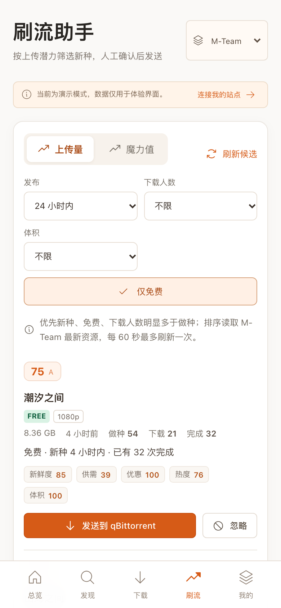
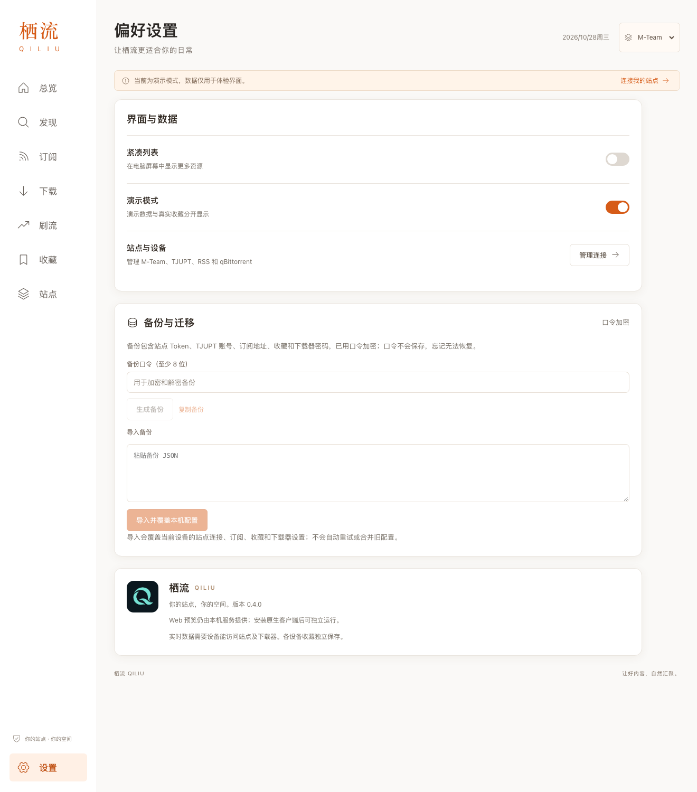
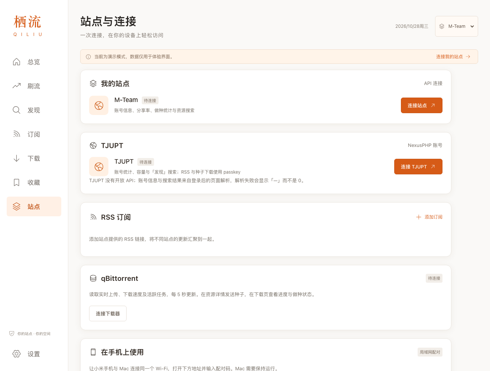

# 栖流 QILIU

> 白色与橙色主题的 PT 工作台：把 M-Team、TJUPT 与 qBittorrent 收进一个界面。

栖流（QILIU，读音 qī liú）是一个自托管的 Private Tracker 工作台。它把站点账号概览、做种与魔力收益、资源发现、RSS 订阅、收藏、刷流候选和 qBittorrent 下载进度放进同一个界面，并同时提供 Web、Windows、Linux、Android、macOS 和 NAS Docker 六种运行形态。

当前版本 **0.5.0**，使用 **MIT** 许可证，需要 **Node.js >= 22**。版本变更见 [CHANGELOG.md](CHANGELOG.md)。

| 形态 | 说明 |
| --- | --- |
| Web | 本机 Node 服务 + 浏览器；支持 PWA 安装，适合桌面预览 |
| Windows | 独立 NSIS 安装包（`.exe`，Windows 10/11），Tauri 2 + WebView2 原生壳 |
| Linux | 独立 `.deb` / `.AppImage`（x86_64，需系统 WebKitGTK 4.1），Tauri 2 原生壳 |
| Android | 独立 APK（Android 8.0+），设备直接联网，不依赖 Mac 或 NAS 常开 |
| macOS | 独立 `.app`（macOS 13+，Apple Silicon / Intel），WKWebView 原生壳 |
| NAS / Docker | 容器常驻，手机与电脑浏览器共享同一实例，适合 7×24 运行 |

## 界面预览

以下截图均使用内置演示数据，不对应任何真实账号。

| 桌面端 · 总览 | 移动端 · 刷流助手 |
| :---: | :---: |
|  |  |

| 设置 · 备份与迁移 | 站点 · M-Team 与 TJUPT |
| :---: | :---: |
|  |  |

## 功能

- **双站点支持**：M-Team 走官方 API，TJUPT（北洋园 PT）走 NexusPHP 登录与页面解析；顶部站点切换器驱动总览、发现和刷流。
- **账号总览**：累计上传、下载、分享率、魔力值、做种汇总、汇总体积与登录剩余；在线做种/下载数与每小时魔力取自 Tracker 上报。
- **M-Team 登录提醒**：按最近访问时间计算 40 天登录倒计时；剩余 ≤7 天时页头出现提醒胶囊、总览顶部显示横幅，≤3 天转为紧急提示，逾期明确提示，点击直达站点登录（高等级/封存账号豁免以站内规则为准）。
- **上传与魔力收益**：区分「站点记账」和「下载器实时速度」，不把两次采样差值当作实时网速。
- **资源发现**：跨站点搜索，按最新/最早/体积/做种排序，支持分类、规格、来源与免费筛选，时间使用相对显示。
- **RSS 订阅**：汇总多个订阅源，缓存结果以减少站点请求；订阅内容也会进入发现与发送流程。
- **收藏**：一键收藏资源，列表只保存在本机，不经过任何云端。
- **刷流助手**：上传量 / 魔力值两种模式，按新鲜度、供需、优惠、热度、体积加权打分，展示评分构成与推荐理由，只排序不自动加种。
- **发送到 qBittorrent**：按精确 info 字节计算种子哈希查重，可选保存目录、分类和「先暂停」，提交后通过任务列表确认结果。
- **下载页**：只读展示每个任务的进度、速度、目录与校验/排队/做种状态，每 5 秒刷新；可开启浏览器或系统完成提醒。
- **站点与连接**：集中管理 M-Team Token、TJUPT 账号或登录 Cookie、RSS 与 qBittorrent；局域网设备通过一次性配对码连接。
- **备份与迁移**：用至少 8 位口令加密导出完整配置，在另一台设备覆盖导入，换机不丢站点与订阅。
- **多端界面**：桌面固定侧栏，手机底部五项导航；390px 与 360px 宽度无横向溢出。
- **Windows / Linux 客户端**：Tauri 2 原生壳复用同一份前端与业务逻辑，设备直连站点与 qBittorrent，不需要常开服务端；凭据加密保存在用户数据目录，安装包随 GitHub Releases 发布。
- **演示模式**：没有凭据也能浏览完整界面，所有演示数据都有明确标记，不会与真实数据混淆。

## 技术栈

- **前端**：React 19 + Vite 6，手写 CSS 实现白色 + 橙色主题，图标来自 Phosphor Icons。
- **服务端**：Node.js 22 + Express 5（ESM），使用原生 `fetch`/`https` 直连站点与下载器。
- **加密**：`@noble/ciphers` + `@noble/hashes`，实现 AES-256-GCM 配置保险箱与 scrypt 口令派生。
- **原生壳**：macOS 使用 Swift + AppKit + WKWebView；Android 使用 Java + WebView；Windows / Linux 使用 Tauri 2（Rust 壳 + 系统 WebView），复用同一份前端与纯 JS 业务模块。
- **桌面端 Rust 核心**：`native/desktop-core` 用纯 Rust 实现站点白名单、SSRF 防护、Vault 加密存储与 HTTP 桥接，并附带 `cargo test` 单元测试。
- **部署**：多阶段 Dockerfile（`node:22-bookworm-slim`）+ Docker Compose，以非 root、只读根文件系统运行。
- **测试与检查**：`node --test`、ESLint 9、Prettier 3、TypeScript `checkJs`、Rust `cargo test`。

## 快速开始

### 环境要求

- Node.js **22 或更高**（项目使用内置 `node --test`、`fetch` 与 Express 5）。
- npm（随 Node.js 安装）。
- 可选：Chrome（运行 `npm run test:ui`）；Xcode 命令行工具（构建 macOS 客户端）；JDK + Android SDK 35（构建 Android 客户端）；Rust stable 与 Tauri 2 系统依赖（构建 Windows / Linux 客户端，Linux 另需系统 WebKitGTK 4.1 开发包）。

### 本机运行

```sh
npm ci
npm run dev
# 打开 http://localhost:4173
```

`npm run dev` 通过 Vite 中间件提供前端热更新；`npm run build && npm start` 则运行生产构建。默认只监听 `127.0.0.1`；需要让局域网内其他设备访问时使用 `npm run start:lan`（监听 `0.0.0.0`，其他设备需要在运行服务的本机上生成配对码）。

本机运行时会在项目根目录创建 `.data/`，用于保存加密后的站点凭据与收藏。**该目录已被 `.gitignore` 排除，永远不要提交或分享。**

### 提交前检查

```sh
npm run check   # lint + 类型检查 + 格式检查 + 语法检查 + 构建
npm test        # 90 多项基于 node --test 的自动化测试
```

## 部署

### NAS / Docker

仓库提供 [`Dockerfile`](Dockerfile)、[`compose.yaml`](compose.yaml) 与 [`.env.example`](.env.example)。容器以非 root 用户运行，数据保存到 `qiliu-data` 命名卷；只需在 NAS 上安装 Docker 与 Compose，无需安装 Node.js。

```sh
cp .env.example .env                       # 填写浏览器实际访问的 QILIU_PUBLIC_ORIGIN
mkdir -p secrets
printf '%s' '至少16位的独立管理密码' > secrets/admin_password.txt
docker compose up -d --build
```

启动后打开 `QILIU_PUBLIC_ORIGIN` 对应的地址，输入管理密码，再到「站点」里填写 M-Team、TJUPT、RSS 与 qBittorrent 连接。完整的端口、IPv6、反向代理、数据备份与排障说明见 [NAS Docker 部署](docs/nas-deployment.md)。

### 桌面与移动客户端

Windows、Linux、Android 与 macOS 客户端都由设备直接访问站点和下载器，不需要额外常开一台服务端 Mac 或 NAS。安装包不进入 Git 仓库，统一通过 **GitHub Releases** 随版本发布；0.5.0 的产物包括 `Qiliu-0.5.0-android.apk`、`Qiliu-0.5.0-mac-universal.zip`，以及 Windows 与 Linux 安装包（NSIS `.exe`、`.deb` 与 `.AppImage`）。源码构建方式如下：

```sh
npm run build
scripts/build-native.sh mac       # 需要 Xcode 命令行工具
scripts/build-native.sh android   # 需要 JDK、Android SDK 35 与签名密钥
npm run desktop:build             # Windows / Linux：先构建前端，再执行 tauri build 当前系统
```

- Windows / Linux：使用 Tauri 2 构建，需要 Rust stable 与 Tauri 系统依赖；Windows 依赖系统 WebView2（Win10/11 一般已预装），Linux 依赖系统 WebKitGTK 4.1。产物在 `src-tauri/target/release/bundle/` 下，包括 NSIS 安装包与 `.deb` / `.AppImage`。安装包未做代码签名，Windows 首次运行可能出现 SmartScreen 提示。详细的系统要求、构建步骤与常见问题见 [Windows / Linux 桌面客户端](docs/desktop-clients.md)。
- macOS：构建为 arm64 + x86_64 通用包，最低 macOS 13；使用本机 Ad-hoc 签名，未做 Apple 公证，首次打开可能需要在「系统设置 → 隐私与安全性」中手动允许。
- Android：最低 Android 8.0（API 26），targetSdk 35；需要设置 `ANDROID_SDK_ROOT`、`QILIU_SIGNING_KEY`、`QILIU_SIGNING_PASSWORD`。覆盖升级必须复用原签名。
- 输出目录可用 `QILIU_INSTALLERS` 指定；`installers/` 与原生编译缓存均已从 Git 排除。

### Web / PWA

`npm run build && npm start` 后即可用浏览器访问，也可在 HTTPS 或 localhost 环境下安装为 PWA。Web 模式适合本机预览；长期运行建议使用 Docker 部署。

## 安全与隐私

- **凭据加密存储**：Web/NAS 使用 `.data/local.key`（权限 0600）+ AES-256-GCM 加密的 `vault.enc`；Windows / Linux 桌面端使用 Tauri `app_data_dir` 下的 `local.key`（Unix 0600）+ `vault.enc`（Windows 位于用户 AppData，按用户 ACL 隔离）；macOS 主密钥保存在系统钥匙串；Android 主密钥保存在 Android Keystore。安装包与仓库都不包含任何账号、Token、passkey 或密码。
- **无遥测**：不包含统计、分析、广告或第三方上报；站点与 qBittorrent 请求由你的设备直接发出，项目没有中转服务器。
- **网络边界**：M-Team 与 TJUPT 请求只允许白名单内的官方主机和固定路径；你添加的 RSS 与种子地址仅接受 HTTPS，并拒绝解析到回环、内网与保留地址（防 SSRF）；HTTPS 证书始终校验。qBittorrent 允许你显式填写 HTTP 地址，此时密码与种子数据以明文传输，请仅在可信网络中使用。桌面端在 Rust 侧执行与 Swift / Java 壳相同的白名单、HTTPS 校验、内网地址拒绝、4 MB 体积上限与 15 秒超时，并禁止跟随重定向。
- **身份认证**：NAS 模式使用管理密码（scrypt 派生、恒定时间比较），会话 24 小时，连续 5 次失败锁定 15 分钟；局域网配对使用 6 位一次性配对码。所有写操作校验自定义请求头与 Origin，并启用 CSP、COOP、`X-Frame-Options: DENY`、`nosniff` 与 `no-referrer`。
- **TJUPT 凭据**：密码登录产生的会话 Cookie 只保存在内存中，不写入磁盘、不回传前端，重启应用后需要重新登录；两步验证账号使用的浏览器登录 Cookie 属于连接凭据，会与账号密码一样加密保存在本机保险箱（Web/NAS 为 `.data/vault.enc`，Windows / Linux 为 `app_data_dir` 下的 `vault.enc`，macOS 为系统钥匙串，Android 为 Keystore），可随加密备份迁移，同样不回传渲染层。
- **备份**：口令经 scrypt 派生后使用 AES-256-GCM 加密，口令本身不保存；备份文件等同于凭据，请妥善保管。
- **最小权限**：Docker 容器以非 root、只读根文件系统、丢弃全部 capabilities 的方式运行；原生壳仅加载应用内打包资源，禁用文件访问与混合内容（Android 还显式关闭 Cookie 与多窗口），外部链接交给系统浏览器。Tauri 桌面壳的 WebView2 / WebKitGTK 由操作系统提供并由系统更新，安装包未签名。

发现安全问题时，请先阅读 [SECURITY.md](SECURITY.md)，通过 GitHub 的私密安全公告报告，不要公开提交含敏感信息的 issue。

## 项目结构

```text
.
├── src/                  React 界面、原生桥接与演示数据
│   ├── App.jsx           页面框架、状态与视图切换
│   ├── Account.jsx       账号概览卡片
│   ├── Activity.jsx      上传与魔力收益面板
│   ├── Downloads.jsx     下载页与发送弹窗、完成提醒
│   ├── Farming.jsx       刷流助手
│   ├── SettingsPage.jsx  设置、备份与迁移
│   ├── SitesPage.jsx     站点与连接
│   ├── ui.jsx            共享 UI 原子组件
│   ├── data.js           API 客户端、演示数据与格式化
│   └── native.js         原生端 Bridge（macOS / Android / Windows / Linux 共用）
├── server/               Web/NAS 服务与共享业务逻辑
│   ├── app.mjs           Express 路由、鉴权与限流
│   ├── model.mjs         站点数据归一化与 RSS 解析
│   ├── farming.mjs       刷流评分（纯函数，原生端共用）
│   ├── tjupt.mjs         TJUPT 登录、页面解析与下载链接
│   ├── downloads.mjs     种子哈希、查重与提交确认
│   ├── qb-client.mjs     qBittorrent WebUI 客户端
│   ├── backup.mjs        口令加密的配置备份
│   ├── network.mjs       出站请求、白名单与 HTTPS 校验
│   └── vault.mjs         本机加密存储
├── src-tauri/            Tauri 2 配置与 Rust 壳（Windows / Linux）
├── native/
│   ├── macos/            Swift + WKWebView 壳
│   ├── android/          Java + WebView 壳
│   └── desktop-core/     纯 Rust 共享核心（白名单/SSRF/Vault/HTTP + 单元测试）
├── scripts/              原生打包与 UI 冒烟脚本
├── tests/                node --test 回归测试与合成夹具
├── public/               图标、PWA 清单与演示图片
├── docs/                 界面截图与补充文档
├── worker/               可选静态资源回退 Worker
├── Dockerfile / compose.yaml
└── package.json
```

站点白名单收敛在 `server/sites.mjs`，服务端与各原生壳共用；Swift / Java 壳与 `native/desktop-core/src/allowlist.rs` 中的清单由 `tests/sites-allowlist.test.mjs` 校验，避免多处漂移。

## 测试

| 命令 | 内容 |
| --- | --- |
| `npm test` | 90 多项 `node --test` 测试：账号、RSS、凭据保险箱、登录鉴权、原生适配、IPv6 URL、二进制 multipart、精确哈希、重复任务、登录过期重试、任务分页、刷流评分、备份加解密、TJUPT 解析/登录/路由、登录倒计时与站点白名单一致性；站点打包检查需先构建，未构建时自动跳过 |
| `npm run test:ui` | 无额外依赖的 UI 冒烟：启动临时服务与无头 Chrome（CDP），检查桌面五个页面、390px 移动布局、侧栏导航与脚本错误 |
| `npm run desktop:test` | `cargo test --manifest-path native/desktop-core/Cargo.toml`：白名单、SSRF 判定、Vault 加解密与 HTTP 参数校验 |
| `npm run lint` | ESLint 检查 `src`、`server`、`tests` |
| `npm run typecheck` | `tsc --checkJs`，覆盖刷流、备份、TJUPT 与新拆出的 UI 组件 |
| `npm run format:check` | Prettier 格式检查（printWidth 120、单引号） |
| `npm run check` | 汇总 lint、类型、格式、语法检查与生产构建 |

`npm run test:ui` 需要本机安装 Chrome，因此不在 CI 中运行；GitHub Actions 工作流见 [`.github/workflows/ci.yml`](.github/workflows/ci.yml)，会在 Node 22 上依次执行 lint、typecheck、format:check、build 与 test。桌面客户端另有 [`.github/workflows/desktop.yml`](.github/workflows/desktop.yml)，在 `windows-latest` 与 `ubuntu-22.04` 上运行 Rust 单元测试（`cargo test --manifest-path native/desktop-core/Cargo.toml`）、构建安装包并上传 artifacts。`npm test` 中的站点打包检查需要先执行 `npm run build`，未构建时会自动跳过。

## 已知限制

- **只适配两个站点**：目前仅支持 M-Team 与 TJUPT；其他 NexusPHP 站点需要自行补充解析与白名单。
- **TJUPT 依赖页面结构**：站点没有开放 API，账号统计与搜索来自 HTML 解析，站点改版后可能暂时读不到；解析失败显示「—」而不是 0。TJUPT 页面不提供累计下载和分享率，界面保持「—」。
- **TJUPT 会话**：密码登录产生的会话 Cookie 仅保存在内存，应用重启后需重新登录；两步验证账号使用的浏览器登录 Cookie 属于连接凭据，会加密保存并可随备份迁移。密码登录遇到两步验证页时会明确提示。
- **刷流只排序**：不会自动加种，也不会修改分享率或做种时长限制；忽略列表只存在当前设备。
- **下载页只读**：暂停、删除、限速等操作请在 qBittorrent 中完成。
- **种子格式**：支持 BitTorrent v1 与 hybrid `.torrent`，元数据上限 4 MB；暂不支持纯 v2 种子、磁力链接，以及需要浏览器 Cookie 才能下载的其他站点。
- **备份是覆盖导入**：不会与现有配置合并，口令忘记后无法恢复。
- **各端配置独立**：Web、Windows、Linux、Android、macOS 各自保存凭据，不做云同步；换机请使用「备份与迁移」。
- **平台验证范围**：macOS 应用为本地 Ad-hoc 签名、未公证；Android APK 需使用同一签名覆盖安装。Windows / Linux 客户端的源码与 CI 构建已经覆盖，但本机为 macOS，**未在实体 Windows / Linux 设备上走查**，安装包需要在对应系统上验收。不同 NAS 型号、Docker 版本与浏览器版本仍可能存在差异。
- **Linux 系统依赖**：桌面客户端依赖发行版提供的 WebKitGTK 4.1（`.deb` 会声明依赖）；`.AppImage` 同样需要系统中存在兼容的 WebKitGTK 与 GTK，缺失时无法启动。
- **Windows 安装包未签名**：NSIS 安装包没有代码签名，SmartScreen 可能提示「Windows 已保护你的电脑」；Linux 安装包同样未做发行版签名。请只从本仓库的 GitHub Releases 下载。
- **qBittorrent 明文 HTTP**：只有在你显式填写 `http://` 时才会使用，密码与种子数据不加密；请优先使用 HTTPS 或可信内网。
- **PWA 安装条件**：需要 HTTPS 或 localhost，局域网纯 HTTP 访问只能作为普通网页使用。

## 参与贡献

欢迎提交 issue 与 pull request。开始之前请阅读 [CONTRIBUTING.md](CONTRIBUTING.md)，其中包含开发环境、检查命令、代码结构与提交约定。请勿在 issue、截图或提交中暴露真实账号、Cookie、passkey、内网地址或 `.data/` 内容。

## 许可证与声明

本项目以 [MIT 许可证](LICENSE) 开源，版权归 QILIU contributors 所有。

栖流是非官方项目，与 M-Team、TJUPT、qBittorrent 及其运营方没有隶属或背书关系；相关名称仅用于说明兼容性。请遵守所在站点规则与当地法律法规，仅管理你有权使用的账号与资源。
